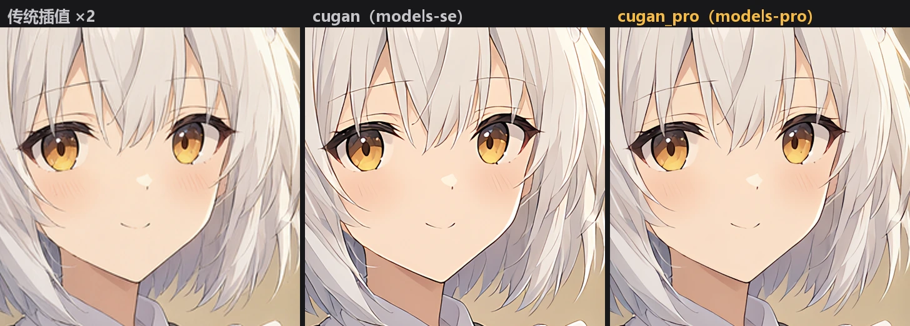
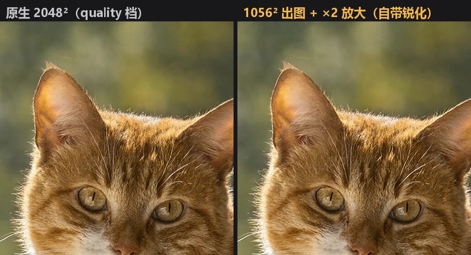
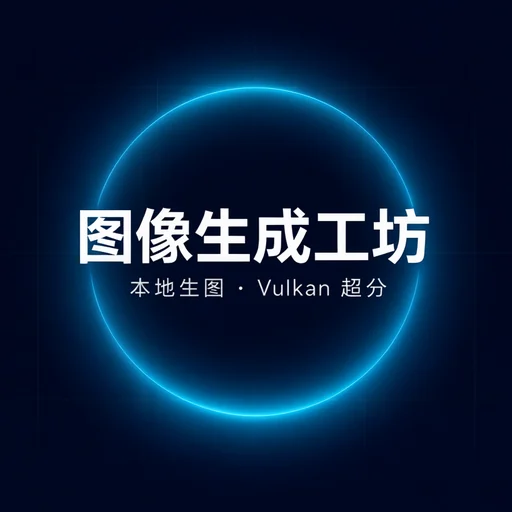

# dsh-imagekit


Local image generation and upscaling for DeepSeek Harness. Includes Qwen-Image text-to-image and reference-image editing, Vulkan super-resolution, pixel tools, ComfyUI engine management and VRAM monitoring.

[简体中文](README.md) · English

[](https://www.npmjs.com/package/dsh-imagekit)
[](LICENSE)
[](#requirements)
[](package.json)

## Install

### Option 1: install inside DSH (recommended)

1. Open DSH, go to Plugins, then Add plugin.
2. Enter the package name `dsh-imagekit` and keep the source at the npm official registry.
3. Click Install, then open the plugin from the plugin list.

### Option 2: command line

```bash
dsh plugin add dsh-imagekit
```

Mirrors such as npmmirror may lag behind. After installation, check the version with `npm ls dsh-imagekit`. If it is older than this document, run:

```bash
npm i dsh-imagekit@latest --registry=https://registry.npmjs.org
```

Development builds use the `beta` tag and are installed separately from stable releases:

```bash
dsh plugin add dsh-imagekit@beta
# or
npm install dsh-imagekit@beta
```

### Option 3: from source

For development or unreleased builds:

```bash
git clone https://github.com/ikeyuchen/dsh-imagekit.git
dsh plugin --profile web add ./dsh-imagekit
```

## First run: download models

The package does not include model weights, the ComfyUI engine or upscale engines. Download them from the settings page before the first generation; otherwise generation reports missing models.

1. Open DSH, go to Plugins → Image Generation Studio → Configure.
2. Confirm the install root under Storage. The default is `%LOCALAPPDATA%\dsh-imagekit`; existing installations keep the previous directory. It can be changed to a larger disk.
3. Under Components & manual download, select an image model pack:

   | VRAM | Pack | Notes |
   | --- | --- | --- |
   | 12 GB | `core` or `fast` | `core` keeps the most detail; `fast` uses turbo and takes about one third of the time |
   | 8 GB | `lowvram` / `lowvram-fast` | w4a8 text encoder to reduce VRAM use |
   | 32 GB | `full` | turbo, ControlNet and dual PE encoders |

4. Download the ComfyUI engine (about 2 GB, required) and the upscale engines (about 190 MB, optional) on the same page.
   An existing ComfyUI portable installation is detected and reused automatically. If it is in another location, set `IMAGEKIT_ENGINE_DIR`.
5. Once every component shows installed, generation is ready. See [usage](docs/USAGE.md).

To remove a single model pack, use Delete pack on that row; only files exclusive to that pack are removed.

## Tools

| Tool | Description |
| --- | --- |
| `image_generate` / `image_generate_raw` | Text-to-image, reference-image editing and custom workflows. Inline API graphs run on the direct backend; templates require the gateway. Provides `draft` / `standard` / `quality` tiers; omitting `tier` uses `standard` |
| `image_workflow_inspect` | Inspect the resolved ComfyUI graph of a gateway template |
| `image_prompt_guide` | Built-in prompt handbook covering tiers, recipes, on-image text, reference edits, upscale routing and capability limits. Returned on demand; the body is not idle context. Tool declaration is about 131 tokA |
| `image_upscale` | 10 presets from official upstream builds: Real-CUGAN, Real-ESRGAN, waifu2x and RealSR (MIT / BSD-3), running on Vulkan |
| 5 pixel tools | Resize, region marking, alpha flattening, frame animation and pose check |
| `comfy` / `image_service_status` | ComfyUI engine start/stop, self-healing and upgrade |
| `image_setup` | Download, verify, back up, roll back and clean models and engines |
| `perf` / `env_probe` / `preflight` | VRAM sampling, environment checks and pre-flight checks for heavy tasks |

Toolsets are registered by profile: `minimal` 6, `standard` 14, `all` 16. The default is `standard`.

## Size and upscaling

Qwen-Image 2.1 has a native resolution of about 2K. Official examples use `2048×2048` at 40 steps, and the official aspect table covers `2048²` to `2752×1536`. The three tiers trade speed for quality; they are not model limits.

| Tier | Size / steps | Measured on 12 GB VRAM | Use case |
| --- | --- | --- | --- |
| `draft` | 1056² / 8 steps (official turbo) | about 8–10 s | Composition and prompt iteration |
| `standard` (default) | 1536² / 25 steps | about 50 s | Everyday output |
| `quality` | 2048² / 40 steps | about 170 s | Final images and extra detail |
| custom | official ratios such as `2752×1536` | same class as 2048² | Landscape or portrait posters |

- Upscaling adds detail, most visibly for anime and illustration: line art and colour-block edges become clearer. `cugan_pro` (models-pro) is the sharpest option. Photos get cleaner fur and material, but detail the model never generated cannot be recovered.
- For a quick 2K result, generate at `draft` 1056² and upscale ×2 with `image_upscale`; this takes about 5 seconds and produces 2112².
- Do not exceed the native range. At 2560² and 25 steps the measured time is about 226 seconds and repeated structures become more likely. Generate at 2048² and upscale instead.
- On 8 GB VRAM, stay at or below 1536² and use a `lowvram` pack. Width and height must be multiples of 32.





## Model packs

| Pack | Steps | Notes |
| --- | --- | --- |
| `core` (standard) | 25 | Best detail and Chinese text; about 30–60 s on a warm engine |
| `fast` (turbo) | 6–8 | Turbo-distilled; about one third of the time, close to standard quality, suitable for drafts |

Both packs can be installed together and share the VAE and text encoder. On 8 GB GPUs, use a `lowvram` pack.

## Samples

<p align="center">
  
  &nbsp;&nbsp;
  
  <br>
  
  &nbsp;&nbsp;
  
</p>
<p align="center"><em>Photoreal, anime, text and scene samples generated locally at the quality tier (2048² / 40 steps). Prompts are in <a href="docs/USAGE.md">usage</a>.</em></p>

## Requirements

- Windows 10/11 x64. The engine and upscale binaries are currently Win64 only.
- No separate Python installation is required. Pixel tools use the Python runtime shipped with DSH, which includes Pillow and numpy. If it is unavailable, `python` and `py` are tried in order; an interpreter with Pillow can be set via `pythonCommand`.
- ComfyUI and Qwen-Image weights are not bundled. Use `image_setup(action="status")` to check missing components.
- No 7-Zip installation is required. `.7z` engine packages are extracted with the official 7-Zip standalone `7zr.exe`, downloaded on first use (about 600 KB, pinned sha256). `.zip` upscale packages are extracted with Node's built-in zlib.
- Generation does not require an external service by default. Text-to-image and reference-image editing are submitted directly to the local ComfyUI instance, without a gateway, Python process or window. Only legacy prompt-enhancer, ControlNet and VNCCS templates require an external compatible gateway.

## Docs

[Usage](docs/USAGE.md) · [Prompt handbook](docs/PROMPTS.md) · [Model & params](docs/MODEL.md) · [Configuration](docs/CONFIGURATION.md) · [Engine versions](docs/ENGINE-VERSIONS.md) · [Architecture](docs/ARCHITECTURE.md) · [Backend comparison](docs/BACKENDS.md) · [Implementation](docs/IMPLEMENTATION.md) · [Icon](docs/ICON.md) · [Releasing](docs/RELEASING.md) · [Changelog](CHANGELOG.md) · [Third-party](THIRD_PARTY.md)

## License

MIT. See [LICENSE](LICENSE). Third-party components and licenses are listed in [third-party notices](THIRD_PARTY.md).

This is a third-party open-source plugin. It is not affiliated with, sponsored by or endorsed by Alibaba / Qwen, the ComfyUI project or DeepSeek. Product names are used only to describe compatibility.
