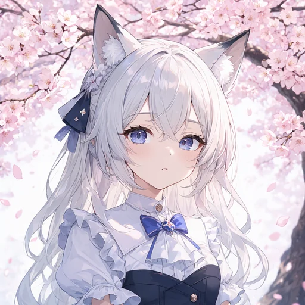

# dsh-imagekit


**Local image generation and upscaling for DeepSeek Harness** — Qwen-Image text-to-image / reference edits, Vulkan super-resolution, plus pixel tools, ComfyUI engine and VRAM monitoring.

[简体中文](README.md) · **English**

[](https://www.npmjs.com/package/dsh-imagekit)
[](LICENSE)
[](#requirements)
[](package.json)

## Install

**Option 1: install inside DSH (recommended)**

1. In DSH open **Plugins → Add plugin**
2. Enter the package name `dsh-imagekit`, keep the source at **npm official registry**
3. Click **Install**, then open the plugin from the plugin list

**Option 2: command line (also npm)**

```bash
dsh plugin add dsh-imagekit
```

**Option 3: from source** (development or unreleased builds)

```bash
git clone https://github.com/ikeyuchen/dsh-imagekit.git
dsh plugin --profile web add ./dsh-imagekit
```

## First run: models are not bundled

The package ships **no** model weights, ComfyUI engine or upscale engines (too large). Download them from the settings page first, otherwise generation reports missing models:

1. DSH → **Plugins → imagekit (Image workshop) → Configure**
2. Confirm the install root under **Storage**
3. Under **Components & manual download → image models**, pick one pack for your VRAM:

   | VRAM | Pack | Notes |
   | --- | --- | --- |
   | 12 GB | `core` or `fast` | `core` keeps the most detail; `fast` is ~3x faster |
   | 8 GB | `lowvram` / `lowvram-fast` | w4a8 text encoder to fit |
   | 32 GB | `full` | turbo + ControlNet + dual PE encoders |

4. Download the **ComfyUI engine** (~2 GB, required) and the **upscale engines** (~190 MB, optional) on the same page
5. Once every row shows *installed*, generate; see [usage](docs/USAGE.md)

> Downloaded the wrong pack? Use **Delete pack** on that row — only its exclusive files are removed.

## Features

| Tool | What it does |
| --- | --- |
| `image_generate` / `image_generate_raw` | Text-to-image, reference-based edits, custom workflows; `draft` / `standard` / `quality` tiers |
| `image_upscale` | 10 Vulkan presets from official upstream builds (Real-CUGAN / Real-ESRGAN / waifu2x / RealSR; MIT + BSD-3) |
| 5 pixel tools | Resize, region marking, alpha flatten, frame animation, pose check |
| `comfy` / `image_service_status` | ComfyUI engine start/stop, self-healing, upgrade |
| `image_setup` | Download, verify, back up, roll back and prune models and engines |
| `perf` / `env_probe` / `preflight` | VRAM sampling, environment checks, pre-flight gates |

Toolsets are registered by profile: `minimal` 5 / `standard` 13 / `all` 15 (default `standard`).

## Size and upscaling

Qwen-Image 2.1 is **native ~2K** (official examples use `2048×2048` at 40 steps; the official aspect table runs from `2048²` to `2752×1536`).
The three tiers trade speed for quality — they are not model limits:

| Tier | Size / steps | Measured on 12 GB VRAM | Good for |
|---|---|---|---|
| `draft` | 1056² / 6 steps | ~10–30 s | composition and prompt iteration |
| `standard` (default) | **1536² / 25 steps** | **~50 s** | everyday output |
| `quality` | 2048² / 40 steps | ~170 s | final images, maximum detail |
| custom | official ratios, e.g. `2752×1536` | same class as 2048² | wide / tall posters |

- **Upscaling really does add detail — very visibly for anime/illustration**: line art and flat colour blocks improve a lot with `cugan_pro` (models-pro); photos get cleaner fur and material, but no detail the model never generated.
- **Cheap 2K**: `draft` 1056² → `image_upscale` ×2 in ~5 s → 2112², handy before committing to a final render.
- **Do not exceed the native range**: 2560² measured 226 s (25 steps) and tends to repeat structures — generate 2048² and upscale instead.
- On 8 GB VRAM stay at or below 1536² with a `lowvram` pack; width/height must be multiples of 32.


## Models
## Models

| Pack | Steps | Notes |
| --- | --- | --- |
| `core` (standard) | 25 | Best detail and Chinese text; ~30–60 s on a warm engine |
| `fast` (turbo) | 6–8 | Turbo-distilled, about 1/3 the time, close to standard quality; good for drafts |

Both packs can be installed together and share the VAE and text encoder; pick `lowvram` on 8 GB GPUs.

## Samples

<p align="center">
  
  &nbsp;&nbsp;
  
  <br>
  
  &nbsp;&nbsp;
  
</p>
<p align="center"><em>Photoreal · anime · text · scene, all generated locally by this plugin (1056² / 1056² / 1024² / 1056²; prompts in <a href="docs/USAGE.md">usage</a>)</em></p>

## Requirements

- Windows 10/11 x64 (engine and upscale binaries are Win64 only for now).
- ComfyUI and Qwen-Image weights are not bundled; check what is missing with `image_setup(action="status")`.
- **No 7-Zip install needed**: the plugin uses a local 7-Zip if present, otherwise the built-in `tar.exe` that ships with Windows 10/11 (it reads both 7z and zip); Linux/macOS need p7zip or bsdtar.
- The generation gateway (default `127.0.0.1:8189`) is a separate service you provide and point the plugin at.

## Docs

[Usage](docs/USAGE.md) · [Prompt handbook](docs/PROMPTS.md) · [Model & params](docs/MODEL.md) · [Configuration](docs/CONFIGURATION.md) · [Engine versions](docs/ENGINE-VERSIONS.md) · [Architecture](docs/ARCHITECTURE.md) · [Implementation](docs/IMPLEMENTATION.md) · [Icon](docs/ICON.md) · [Releasing](docs/RELEASING.md) · [Roadmap](docs/ROADMAP.md) · [Changelog](CHANGELOG.md) · [Third-party](THIRD_PARTY.md)

## License

MIT. This is a third-party open-source plugin, not affiliated with, sponsored or endorsed by Alibaba / Qwen, the ComfyUI project, or DeepSeek. Product names are used only to describe compatibility.
