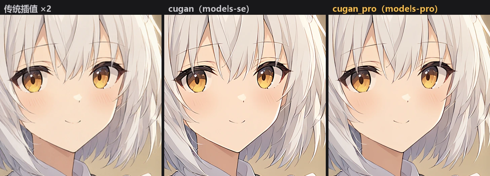
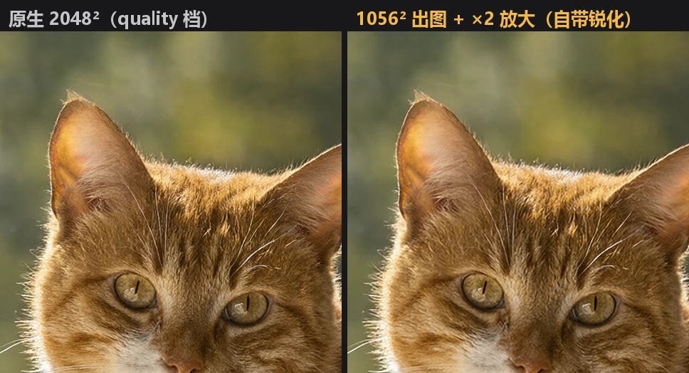

# dsh-imagekit


面向 DeepSeek Harness 的本地生图与放大插件。提供 Qwen-Image 文生图与参考图编辑、Vulkan 超分，以及像素处理、ComfyUI 引擎管理与显存监测。

[简体中文](README.md) · [English](README.en.md)

[](https://www.npmjs.com/package/dsh-imagekit)
[](LICENSE)
[](#要求)
[](package.json)

## 安装

### 方式一：DSH 内安装（推荐）

1. 打开 DSH，进入「插件」页面，选择「添加插件」。
2. 输入包名 `dsh-imagekit`，安装源保持「npm 官方源」。
3. 点击「安装」，完成后在插件列表中打开。

### 方式二：命令行

```bash
dsh plugin add dsh-imagekit
```

国内镜像（npmmirror）存在同步延迟，安装后可用 `npm ls dsh-imagekit` 核对版本。若版本落后于本文档，可执行：

```bash
npm i dsh-imagekit@latest --registry=https://registry.npmjs.org
```

开发版使用 `beta` 标签，与稳定版分开安装：

```bash
dsh plugin add dsh-imagekit@beta
# 或
npm install dsh-imagekit@beta
```

### 方式三：源码

用于开发或未发布版本：

```bash
git clone https://github.com/ikeyuchen/dsh-imagekit.git
dsh plugin --profile web add ./dsh-imagekit
```

## 首次使用：下载模型

插件包不包含模型、ComfyUI 引擎与放大引擎。首次使用需在设置页完成下载，否则生图会提示缺少模型。

1. 打开 DSH，进入「插件」→「图像生成工坊」→「配置」。
2. 在「存储位置」确认安装根目录。默认目录为 `%LOCALAPPDATA%\dsh-imagekit`；旧版本已安装的机器沿用原目录，也可改到大容量磁盘。
3. 在「组件与手动下载」中选择生图模型包：

   | 显存 | 模型包 | 说明 |
   | --- | --- | --- |
   | 12 GB | `core` 或 `fast` | `core` 细节表现最佳；`fast` 使用 turbo，耗时约为 `core` 的 1/3 |
   | 8 GB | `lowvram` / `lowvram-fast` | 使用 w4a8 文本编码器，降低显存占用 |
   | 32 GB | `full` | 包含 turbo、ControlNet 与 PE 双编码器 |

4. 在同一页面下载 ComfyUI 引擎（约 2 GB，生图必需）与图片放大引擎（约 190 MB，可选）。
   若本机已有 ComfyUI 便携版，插件会自动复用；位置不同可通过环境变量 `IMAGEKIT_ENGINE_DIR` 指定。
5. 所有组件显示「已安装」后即可生图。具体用法见[用法](docs/USAGE.md)。

删除单个模型包时，使用该行的「删除该包」，仅清理该包独有的文件。

## 工具

| 工具 | 说明 |
| --- | --- |
| `image_generate` / `image_generate_raw` | 文生图、参考图改图、任意工作流。整份 API 图可离线直连，模板需要网关。提供 `draft` / `standard` / `quality` 三档，省略 `tier` 时使用 `standard` |
| `image_workflow_inspect` | 查看网关模板解析后的 ComfyUI 图 |
| `image_prompt_guide` | 内置提示词手册，包含选档、分类配方、文字渲染、参考图编辑、放大路由与能力边界；按需返回，手册正文不占常驻上下文，工具声明约 131 tokA |
| `image_upscale` | Real-CUGAN / Real-ESRGAN / waifu2x / RealSR，共 10 个预设，来自上游官方 MIT/BSD 构建，Vulkan 直通 GPU |
| 像素处理 5 件 | 降采样、区域标记、透明扁平化、动图合成、姿势检查 |
| `comfy` / `image_service_status` | ComfyUI 引擎启停、自愈与升级 |
| `image_setup` | 模型与引擎的下载、校验、备份回滚与旧版本清理 |
| `perf` / `env_probe` / `preflight` | 显存采样、环境体检、重任务前置检查 |

工具按档位注册：`minimal` 6 件、`standard` 14 件、`all` 16 件，默认 `standard`。

## 尺寸与放大

Qwen-Image 2.1 原生分辨率约为 2K。官方示例使用 `2048×2048`、40 步；官方比例表覆盖 `2048²` 至 `2752×1536`。本插件的三档尺寸按速度与画质划分，并非模型限制。

| 档位 | 尺寸 / 步数 | 12 GB 显存实测 | 适用场景 |
| --- | --- | --- | --- |
| `draft` | 1056² / 8 步（官方 turbo） | 约 8–10 秒 | 构图与提示词迭代 |
| `standard`（默认） | 1536² / 25 步 | 约 50 秒 | 日常出图 |
| `quality` | 2048² / 40 步 | 约 170 秒 | 成片、需要更多细节 |
| 自定义 | 官方比例 `2752×1536` 等 | 与 2048² 同档 | 横版或竖版海报 |

- 放大可增加细节，二次元与插画效果较明显：线稿与色块边界更清晰。`cugan_pro`（models-pro）锐度最高；写实照片的毛发与材质也会更干净，但无法补出模型未生成的细节。
- 快速得到 2K：`draft` 1056² 出图后使用 `image_upscale` ×2，约 5 秒得到 2112²，适合先确认构图再定稿。
- 不建议超过原生范围：2560²、25 步实测约 226 秒，且容易出现重复结构。需要更大画幅时，先生成 2048² 再放大。
- 8 GB 显存建议不超过 1536²，并使用 `lowvram` 包。宽高必须为 32 的倍数。





## 模型包

| 包 | 步数 | 说明 |
| --- | --- | --- |
| `core`（标准） | 25 | 细节与中文文字最稳；热引擎约 30–60 秒 |
| `fast`（快速） | 6–8 | turbo 蒸馏，耗时约为 `core` 的 1/3，质量接近标准，适合草稿迭代 |

两个包可同时安装，共用 VAE 与文本编码器。8 GB 显存建议选择 `lowvram` 包。

## 示例

<p align="center">
  
  &nbsp;&nbsp;
  
  <br>
  
  &nbsp;&nbsp;
  
</p>
<p align="center"><em>写实、二次元、文字、场景均由本插件本地生成，使用 quality 档 2048² / 40 步，提示词见<a href="docs/USAGE.md">用法</a>。</em></p>

## 要求

- Windows 10/11 x64。引擎与超分二进制目前仅提供 Win64 版本。
- 无需单独安装 Python。像素工具默认使用 DSH 自带的 Python 运行时（包含 Pillow/numpy）；缺失时依次尝试 `python`、`py`，仍不可用则通过 `pythonCommand` 指定安装有 Pillow 的解释器。
- ComfyUI 与 Qwen-Image 权重不随包分发。缺少组件时可用 `image_setup(action="status")` 查看。
- 无需安装 7-Zip。`.7z` 引擎包由插件按需下载官方 7-Zip 精简版 `7zr.exe`（首次约 600 KB，sha256 固定校验）解压；`.zip` 放大包由 Node 内置 zlib 解压。
- 默认生图不依赖外部服务。文生图与参考图编辑由插件直接向本机 ComfyUI 提交工作流，不需要网关、Python 进程或窗口。只有 Prompt 增强、ControlNet、VNCCS 等旧模板需要外部兼容网关。

## 文档

[用法](docs/USAGE.md) · [提示词手册](docs/PROMPTS.md) · [模型与参数](docs/MODEL.md) · [配置](docs/CONFIGURATION.md) · [引擎版本](docs/ENGINE-VERSIONS.md) · [架构](docs/ARCHITECTURE.md) · [实现](docs/IMPLEMENTATION.md) · [图标](docs/ICON.md) · [发布](docs/RELEASING.md) · [变更](CHANGELOG.md) · [第三方](THIRD_PARTY.md)

## 许可

本项目使用 MIT 许可，全文见 [LICENSE](LICENSE)。第三方组件与许可见[来源说明](THIRD_PARTY.md)。

本项目为第三方开源插件，与阿里巴巴 / Qwen、ComfyUI 项目、DeepSeek 及其关联方无隶属、赞助或背书关系。文中产品名仅用于说明兼容性。
