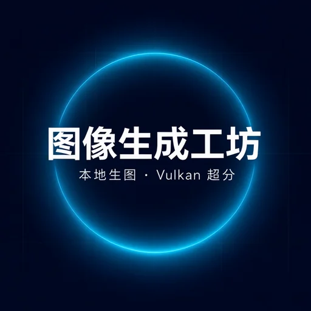

# dsh-imagekit


**本地生图与放大的 DeepSeek Harness 插件**：Qwen-Image 文生图 / 参考图改图、Vulkan 超分，附像素处理、ComfyUI 引擎管理与显存监测。

[简体中文](README.md) · [English](README.en.md)

[](LICENSE)
[](#要求)
[](package.json)

## 安装

在插件市场搜索 **`dsh-imagekit`** 安装，或从源码：

```bash
git clone https://github.com/ikeyuchen/dsh-imagekit.git
dsh plugin --profile web add ./dsh-imagekit
```

> npm 尚未发布；发布后可直接 `dsh plugin --profile web add dsh-imagekit`。

## 能力

| 工具 | 说明 |
| --- | --- |
| `image_generate` / `image_generate_raw` | 文生图、参考图改图、任意工作流；`draft` / `standard` / `quality` 三档 |
| `image_upscale` | Real-CUGAN / Real-ESRGAN / waifu2x / Omni 等 12 个预设，Vulkan 直通 GPU |
| 像素处理 5 件 | 降采样、红圈标记、透明扁平化、动图合成、姿势检查 |
| `comfy` / `image_service_status` | ComfyUI 引擎启停、自愈、升级 |
| `image_setup` | 模型与引擎的下载、校验、备份回滚、旧版本清理 |
| `perf` / `env_probe` / `preflight` | 显存采样、环境体检、重活前置闸门 |

工具集按档位注册：`minimal` 5 件 / `standard` 13 件 / `all` 15 件，默认 `standard`。

## 模型

| 包 | 步数 | 说明 |
| --- | --- | --- |
| `core`（标准） | 25 | 细节与中文文字最稳；热引擎约 30–60 秒 |
| `fast`（快速） | 6–8 | turbo 蒸馏，耗时约 1/3，质量接近标准；适合草稿迭代 |

两个包可同时安装、共用 VAE 与文本编码器；8G 显存选 `lowvram` 包。

## 示例

<p align="center">
  
  &nbsp;&nbsp;
  
  <br>
  
  &nbsp;&nbsp;
  
</p>
<p align="center"><em>写实 · 二次元 · 文字 · 场景，均由本插件本地生成（1056² / 1056² / 1024² / 1056²，提示词见 <a href="docs/USAGE.md">用法</a>）</em></p>

## 要求

- Windows 10/11 x64（引擎与超分二进制目前只有 Win64 版本）。
- ComfyUI、Qwen-Image 权重、7-Zip 均不随包分发，缺什么用 `image_setup(action="status")` 查。
- 生图网关（默认 `127.0.0.1:8189`）是独立服务，需自备并在设置里指向它。

## 文档

[用法](docs/USAGE.md) · [提示词](docs/PROMPTS.md) · [模型与参数](docs/MODEL.md) · [配置](docs/CONFIGURATION.md) · [架构](docs/ARCHITECTURE.md) · [实现](docs/IMPLEMENTATION.md) · [图标](docs/ICON.md) · [发布](docs/RELEASING.md) · [路线图](docs/ROADMAP.md) · [变更](CHANGELOG.md) · [第三方](THIRD_PARTY.md)

## License

MIT。本项目是第三方开源插件，与阿里巴巴 / Qwen、ComfyUI 项目、DeepSeek 及其关联方无隶属、赞助或背书关系；文中产品名仅作兼容性的事实性指代。
