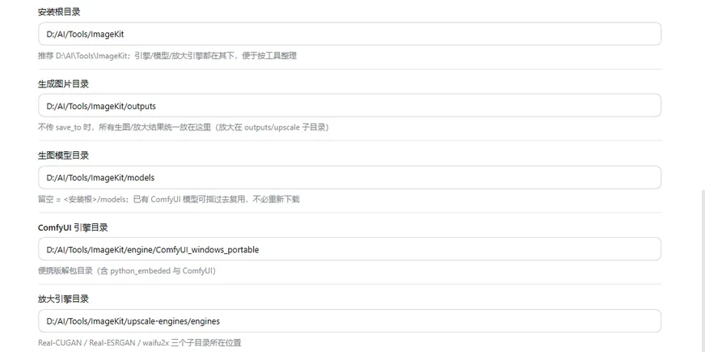

# 用法与排障

> 面向"我要真的用起来"的问题：生图模型怎么调、编辑怎么走、放大怎么选、跑不动怎么办。
> 提示词写法见 [PROMPTS.md](./PROMPTS.md)（探索版）；内置核心手册随包分发，用 `image_prompt_guide` 按需读取。

## 0. 初始化：先下模型，再出图（只做一次）

插件本体不含模型与引擎。**装完插件先去设置页下载**，否则第一次生图会报缺模型：

1. DSH →「插件」→「图像生成工坊」→「配置」
2. 「存储位置」确认安装根目录（默认 `<盘符>/AI/Tools/ImageKit`）
3. 「组件与手动下载」→ 生图模型，按显存选包：12G 用 `core` / `fast`，8G 用 `lowvram` / `lowvram-fast`，32G 用 `full`
4. 同页下载 ComfyUI 引擎（约 2 GB，必需）、图片放大引擎（约 190 MB，可选）
5. 全部显示「已安装」即可继续；装错了用该行「删除该包」只删那一个

> 解压**不需要**你装 7-Zip：`.7z` 引擎包由插件内置的官方 7zr（首次自动下载 600 KB）解压，`.zip` 放大包由 Node 内置解压。
> `image_setup(action="status")` 会显示当前用的解压器（`extractor:` 一行）。

命令行等价写法（不确定用哪个包时先跑 status）：

| 需要什么 | 怎么查 | 怎么装 |
|---|---|---|
| 生图引擎（ComfyUI） | `comfy(action="status")` | 设置页组件区，或 `image_setup(action="install", component="engine")` |
| 生图模型权重 | `image_setup(action="status")` | `image_setup(action="install", component="models", pack="core")`（**pack 必填**，按显存选） |
| 放大引擎 | `image_setup(action="status")` | `image_setup(action="install", component="upscale")` |
| 显存够不够 | `preflight` / `perf(action="snapshot")` | 12G 用默认档；8G 装 `lowvram` 包 |

`image_setup(action="status")` 会同时给出**已装版本、缺什么、可升级到哪个版本**；
模型包是**可叠加**的（`core` 标准 + `fast` turbo 可以同时装），不必二选一。

## 0.5 第一次用：三条命令出图

装好模型后（见 §0），照抄下面三步就能出第一张图：

```text
# 1) 迭代：draft 档，6 步 turbo，10 秒级
image_generate(tier="draft",
  prompt="一只橘白相间的短毛猫坐在浅色木质窗台上，午后阳光从左侧斜射进来，毛发边缘有轮廓光，背景是虚化的绿植，写实摄影，浅景深")

# 2) 满意后定稿：换 standard 或 quality
image_generate(tier="standard", seed=<上一步的 seed>, prompt="<同上>")

# 3) 想更大：直接放大
image_upscale(input_path="<上一步输出路径>", engine="cugan")
```

三条经验（都是实测，见 [MODEL.md](./MODEL.md)）：

1. **提示词写成一句话的画面描述**，别堆 `masterpiece, 8k, --ar 3:2`；
2. **迭代用 `draft`**：turbo 6 步和 25 步质量同级，时间只要 1/3；
3. **画幅用 `width`/`height`**（32 的倍数），不要写进提示词。

### 示例提示词（README 三张配图）

```text
# 写实：1536² / 25 步（standard）
一张写实摄影照片：一只橘白相间的短毛猫坐在浅色木质窗台上，午后阳光从左侧斜射进来，
毛发边缘有轮廓光，背景是虚化的绿植，浅景深，50mm 定焦，柔和侧逆光，色彩自然。

# 二次元：1536² / 25 步
anime illustration of a silver-haired girl with fox ears standing under a cherry blossom tree,
cel-shaded, clean line art, vibrant colors, detailed eyes, upper body, soft rim light,
petals drifting in the air, shallow depth of field

# 场景：1536² / 25 步
电影感风景照片：黄昏时分的山谷湖泊，湖面倒映着粉紫色晚霞与连绵远山，前景是长满野花的草坡，
薄雾贴着水面，光线柔和通透，广角构图，色彩层次丰富，画面干净通透。

# 文字：1024² / 40 步（含文字建议 40 步）
一张方形极简科技海报：深藏青纯色背景，画面中央是发光的青蓝色渐变圆环与细网格线，
柔和光晕向外扩散，顶部大号白色粗体标题写着「图像生成工坊」，标题下方一行浅灰细体小字
「本地生图 · Vulkan 超分」，底部一行细体英文「dsh-imagekit」，居中构图，干净排版。
```

## 1. 文生图（默认路径）

> 不需要网关：文生图与参考图编辑都由插件直接向本机 ComfyUI 提交工作流（内置直连）。
> 只有 Prompt 增强（`*_pe`）/ ControlNet / VNCCS 等旧模板才需要 `gatewayUrl` 指向的兼容网关。

```
image_generate(prompt="<按 PROMPTS.md 的六槽写>")
```

- 默认走 `qwen_image_2_1_t2i`，**1536×1536、25 步、CFG 1.0**（`tiers.json` 为准）
- 常用参数：`width/height`（32 的倍数）、`steps`、`seed`（复现同一张）、`batch_size`（1–8）
- 不传 `save_to` → 全部落 `outputDir`（默认 `<installRoot>/outputs`）
- 慢任务加 `run_in_background: true`，再用 `job_output` 取结果；`job_list` 看全部任务，`job_kill` 取消
- 需要完全自定义工作流时用 `image_generate_raw`（`from_template` + `node_overrides` 按节点改，或直接给整份 `workflow`）

**档位（tier）** 是参数预设，省得记数字：

| tier | 模板 | 步数 | 尺寸 | 用途 |
|---|---|---|---|---|
| `draft` | t2i_turbo | 6 | 1056² | 试构图，几秒出图 |
| `standard`（默认） | t2i | 25 | **1536²** | 常规出图 |
| `quality` | t2i | 40 | 2048² | 终稿，分钟级 |

显式参数优先于档位（`tier="draft", steps=20` → 用 20 步）。

**文字类需求**可直接把版式写进提示词（见 [PROMPTS.md](./PROMPTS.md)）；`qwen_image_2_1_cn`、`qwen_image_2_1_t2i_pe` 属旧模板，**需要外部兼容网关**（内置直连不覆盖），日常优先用默认模板。

## 2. 图生图 / 编辑

```
image_generate(prompt="把 <image1> 里的猫换成橘白短毛猫，其余保持不变",
               ref_images=["<你的图片路径>"])
```

- **传了 `ref_images` 就会自动切到编辑模板**（`qwen_image_2_1_edit`），不用手填 template
- 参考图在 prompt 里用 `<image1> <image2> …` 指代，顺序 = `ref_images` 顺序，最多 10 张
- 显式写了 t2i 模板又传参考图 → 会**直接报错**并提示改法（不静默丢弃参考图）
- 多图合成用 `qwen_image_2_1_edit3`（3 张）/ `edit6`（6 张）；局部重绘强度用 `denoise`（0.4–0.7 保结构，1.0 重生成）

## 2.5 尺寸怎么选（原生 2K vs 放大）

Qwen-Image 2.1 是**原生约 2K** 的模型：官方示例 `2048×2048`、40 步，官方比例表从 `2048²`（1:1）到 `2752×1536`（16:9）。
插件的三档是在这个范围内按「速度 ↔ 画质」分的：

| 档位 | 尺寸 / 步数 | 12G 显存实测 | 适合 |
|---|---|---|---|
| `draft` | 1056² / 6 步 | 10–30 秒 | 构图、提示词迭代（细节/文字弱） |
| `standard`（默认） | **1536² / 25 步** | **约 50 秒** | 日常出图，画质与速度平衡 |
| `quality` | 2048² / 40 步 | 约 170 秒 | 成片、要最实细节（与官方示例一致） |
| 自定义 | 官方比例 `2752×1536`、`2528×1696`、`1536×2752` | 与 2048² 同档 | 横竖幅海报 |

**省时间的做法**：`draft` 1056² 先出构图 → 满意后用 `standard`/`quality` 重画同 seed；只是要更大图、不追新细节时，也可以 `image_upscale` ×2（约 5 秒）。

### 放大确实能加细节，二次元尤其明显

- **动漫 / 插画**：线稿、色块、发丝纹理提升非常直观，`cugan_pro`（models-pro）比 `cugan`（models-se）更锐：


- **写实照片**：毛发、材质边缘会更干净（`waifu2x_photo` / `photo_hq` / `realsr`），但补不出模型没有生成的写实纹理；要写实细节，`quality` 档原生 2048² 比放大更实。


- 8G 显存建议 ≤1536² 并选 `lowvram` 包；宽高必须是 **32 的倍数**
- 更大画布/超分后再降采样的取舍，见 [MODEL.md 的像素预算](./MODEL.md#6-像素预算与清晰度实测经验)
- 超过原生不建议：2560² 25 步实测 226 秒，且容易出现重复结构

## 3. 放大

```
image_upscale(input_path="<outputDir>/xxx.png")
```

按内容选引擎（不传就是 `cugan`；二次元要更锐用 `cugan_pro`）：

| 内容 | 引擎 |
|---|---|
| 动漫 / 插画 / 二次元 | **`cugan_pro`（最锐，×2/×3 首选）**、`cugan`（默认，支持 ×4）、`cugan_cons`（保守，防画风漂移）、`waifu2x`、`esrgan_anime`（×2/×3/×4）、`esrgan_hq`（×4 Anime-HQ） |
| 真人照片 | `photo_hq`（Real-ESRGAN x4plus ×4）、`waifu2x_photo`、`realsr`（保守修复 ×4）、`realsr_jpeg`（对 JPEG 伪影更稳） |
| 3D 渲染 / 通用 | `photo_hq`（x4plus 通用写实）、`realsr`（少增细节）、`esrgan_anime`（要 ×2 快速时） |

- 引擎全部来自**上游官方** ncnn 构建（MIT / BSD-3）：Real-CUGAN、waifu2x、Real-ESRGAN、RealSR
- 引擎怎么按内容选、后处理顺序、不该放大的情况：[MODEL.md 的放大与后处理路由](./MODEL.md#7-放大与后处理路由)
- `scale` 默认按引擎（cugan ×2、esrgan_hq/realsr ×4）；`denoise` 只有 `cugan` 开放 0–3（×2 全档，×3/×4 仅 0/3），
  `cugan_pro` 也支持 0/3，`waifu2x` / `cugan_cons` 固定 0
- 输出默认 `<outputDir>/upscale/`，可传 `save_to`
- **只吃本地文件**：先生成/下载到磁盘再放大，不吃 URL
- 引擎没装 → 先 `image_setup(action="install", component="upscale")`（四包合计约 190 MB）
- **带透明的图先扁平化**：`image_upscale` 不做 alpha 处理（可能静默丢透明通道），用 `image_flatten_alpha` 压到底色再放
  （该工具在 `standard` 档；`minimal` 档请自行在外部处理）
- 放大倍率按**最终用途**定：屏幕看图 ×2 足够；打印/裁切再上 ×4（1056² ×4 = 4224²，约 12 秒）

## 3.5 组件与旧版本

- 装什么：设置页「组件与手动下载」逐个点「下载 / 安装」；模型包可**叠加**（core + fast 能同时装）。
- 下载默认开 **4 条连接分片**（限速线路实测 1.4–3.8×；服务端不支持 Range 时自动回退单流），设置页「下载源」可改成 1/2/4/8
- 下载时会显示**进度条**（百分比 + 已下载/总量 + 当前文件名 + 实时速度 + 剩余时间），下载完自动转入解压；
  设置页每秒轮询一次，进度与速度都是实时刷新，不需要手动刷新页面
- 行内动作按状态变化：**版本不同**才显示「升级」，**版本对但缺文件**显示「修复」；
  下载/升级进行中，该行的动作按钮会隐藏或锁定，避免重复触发。
- 装错了：每个已安装的模型包右侧有「删除该包」，**只删这个包独有的文件**；与其他已安装包共用的文件会保留（删了会连带坏掉那些包），删完会列出保留项。
- 全部清空：组件行的「删除」会删掉 `models` 下所有模型文件，确认框里会明确提示。
- 命令行等价写法：`image_setup(action="delete", component="models", pack="core", confirm="models")`。
- 装完自检：`image_setup(action="verify", component="models")`，校验大小与 sha256。
- 升级：组件行出现「可升级 → vX」时点「升级」；旧内容先 `rename` 进
  `<installRoot>/.imagekit/backups/<component>/<版本>-<时间戳>/`，失败自动回滚。
- 删旧版本：组件下方「旧版本备份 (n)」逐行删；`keepVersions`（默认 1）控制升级后保留几份。

## 4. 常见故障

| 现象 | 原因 | 处理 |
|---|---|---|
| `image_generate` 报网关连不上 | 引擎/网关没起 | `comfy(action="control", op="start")`，或看 `image_service_status` |
| 首次出图特别慢（7–20s 起） | 模型冷加载 | 正常；连续生成会快 |
| 显存被模型占着不释放 | 模型常驻属正常 | 生成时传 `unload_after=true` 立刻释放；或调 `vramIdleFreeMinutes`（默认 10 分钟）自动释放 |
| 报「Image gateway unreachable」 | 用了旧模板（`*_pe` / `cn` / `vnccs`）但没装网关 | 文生图/编辑改回 `generationBackend=auto`；旧模板需要兼容网关 |
| CUDA/显存不足 | 12G 显存跑了 2K | 降 `tier="standard"`、改装 `lowvram` 模型包，或 `comfy(action="control", op="free")` |
| 生成的是新图、没按参考图改 | 模板是 t2i | 现在会自动切 edit；若手填了 t2i 会报错，按提示改 |
| 出图没有透明底 | 没在 prompt 里写 | 加 `透明背景` / `transparent background` |
| 放大报"模型文件缺失" | 引擎升级后目录变了 | `image_setup(action="install", component="upscale")` 重装 |
| 中文文字糊 | 提示词太含糊 | 文字加引号原文；实测 `t2i_turbo` 也能正确渲染中文 |
| 报 `VBAR allocation failed` | 引擎长跑（数小时）后 CUDA 地址分配失败 | `comfy(action="control", op="restart")`，首张图有 7–20 秒加载 |

## 5. 工具集档位（省 token）

插件只有两个功能：**生图** 与 **放大**。其余工具只在需要时才有用，所以按档位注册：

| 档位 | 工具数 | 常驻 token（tokA / tokB） | 含什么 |
|---|---|---|---|
| `minimal` | 6 | **1144 / 1337** | `image_generate`、`image_prompt_guide`、`image_upscale`、`image_service_status`、`image_setup`、`comfy` |
| `standard`（默认） | 14 | **2524 / 2945** | minimal + `image_generate_raw`、`image_workflow_inspect` + 像素处理 5 件 + `perf` |
| `all` | 16 | **2824 / 3304** | standard + `env_probe`、`preflight` |

口径（估算）：宿主只发 `name + description + parameters`（outputSchema 不发）+ 提示段；tokA = CJK 1.6 / ASCII 4.2 字每 token，tokB 为保守值。
随时可复测：`npm run tokens`。

只做生图和放大就把档位设成 `minimal`；要跑自己的 ComfyUI 工作流或改图（resize/标记/合成帧）再用 `standard`。

档位在设置页「自动行为 → 工具集档位」里切换：



档位控件在「自动行为 → 工具集档位」分组。
