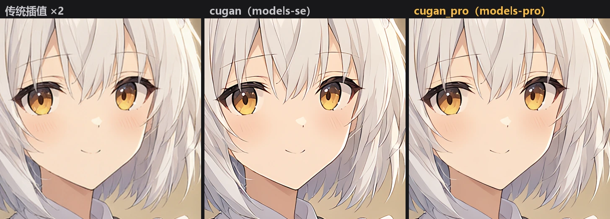
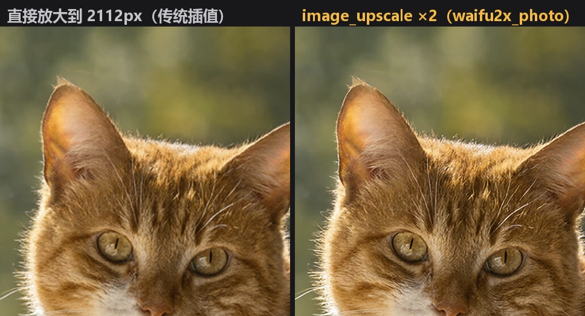

# 用法与排障

> 本文说明实际使用与故障处理，包括模型与引擎选择、编辑流程、放大策略和常见问题。
> 提示词写法见 [PROMPTS.md](./PROMPTS.md)（探索版）；内置手册随包分发，由 `image_prompt_guide` 按需读取。

## 0. 初始化：下载模型与引擎（仅首次）

插件包不包含模型与引擎。安装后需在设置页下载组件，否则首次生图会提示缺少模型：

1. DSH →「插件」→「图像生成工坊」→「配置」
2. 「存储位置」确认安装根目录（默认 `%LOCALAPPDATA%\dsh-imagekit`，旧版装过的机器沿用原目录）
3. 在「组件与手动下载」中选择生图模型包：12 GB 显存使用 `core` 或 `fast`，8 GB 使用 `lowvram` 或 `lowvram-fast`，32 GB 使用 `full`。
4. 在同一页面下载 ComfyUI 引擎（约 2 GB，必需）与图片放大引擎（约 190 MB，可选）。
5. 所有组件显示「已安装」后即可继续。安装错误的模型包可通过该行的「删除该包」移除。

> 解压无需安装 7-Zip：`.7z` 引擎包由插件按需下载的官方 7zr（首次 600 KB）解压，`.zip` 放大包由 Node 内置解压。
> `image_setup(action="status")` 会显示当前用的解压器（`extractor:` 一行）。

命令行等价写法（不确定使用哪个包时先执行 `status`）：

| 需要什么 | 查询方式 | 安装方式 |
|---|---|---|
| 生图引擎（ComfyUI） | `comfy(action="status")` | 设置页组件区，或 `image_setup(action="install", component="engine")` |
| 生图模型权重 | `image_setup(action="status")` | `image_setup(action="install", component="models", pack="core")`（pack 必填，按显存选择） |
| 放大引擎 | `image_setup(action="status")` | `image_setup(action="install", component="upscale")` |
| 显存是否足够 | `perf(action="snapshot")`（`preflight` 需要 `all` 档） | 12 GB 使用默认档；8 GB 安装 `lowvram` 包 |

`image_setup(action="status")` 会同时给出已安装版本、缺少的组件与可升级版本；
模型包支持叠加安装（`core` 与 `fast` 可同时安装），无需二选一。

## 0.5 首次出图示例

完成模型与引擎安装后（见 §0），可按以下步骤生成第一张图：

```text
# 1) 迭代：draft 档，官方 turbo 8 步，约 10 秒
image_generate(tier="draft",
  prompt="一只橘白相间的短毛猫坐在浅色木质窗台上，午后阳光从左侧斜射进来，毛发边缘有轮廓光，背景是虚化的绿植，写实摄影，浅景深")

# 2) 定稿：切换 standard 或 quality
image_generate(tier="standard", seed=<上一步的 seed>, prompt="<同上>")

# 3) 需要更大尺寸：执行放大
image_upscale(input_path="<上一步输出路径>", engine="cugan")
```

注意事项（实测记录见 [MODEL.md](./MODEL.md)）：

1. 提示词写成一段连贯的画面描述，不要堆叠 `masterpiece, 8k, --ar 3:2`；
2. 迭代使用 `draft`：官方 turbo 8 步实测画质接近 25 步（SSIM 0.93），时间约为 1/3；
3. 画幅通过 `width` / `height` 指定，取值为 32 的倍数，不要写进提示词。

> seed 复现的边界：同一 seed 只在相同尺寸、模型与步数下复现。`draft`（1056²）切换到 `standard`（1536²）会改变尺寸，构图随之变化。需要保留构图时使用 `image_upscale` 放大，或从 draft 图执行 i2i / `denoise` 0.7–0.9。生成结果会回显实际 seed。

### 示例提示词（README 四张配图，均为 `quality` 档 2048² / 40 步）

四条都按「主体 → 场景 → 风格 → 构图与光线」写：风格词只出现一次，光照单独一句，
结尾一句收构图。

```text
# 写实
一只橘白相间的短毛猫坐在浅色木质窗台上，午后阳光从左上斜射进来，在毛发边缘勾出轮廓光，
背景是虚化的绿植与模糊窗框，写实摄影，85mm 镜头，浅景深，暖色调，身体朝向左侧但头部转向镜头。
The lighting is soft late-afternoon sunlight from the upper left.
The overall composition is centered with generous negative space on the right.

# 二次元（发色、瞳色与服装逐项明确指定，避免漂移）
一名猫娘女仆站在洒满阳光的洋馆走廊里，银白色短发，头顶一对白色猫耳内耳粉色，琥珀色眼睛，
黑色长裙女仆装配白色褶边围裙与深蓝色领结，双手在身前捧着银色托盘，身后是拱形窗与浅色石墙，
赛璐璐上色，干净线稿，平涂，背景为平涂色块加平滑渐变，半身构图。
The lighting is warm morning sunlight through the arched windows, with soft rim light on the hair.
The overall composition places the character slightly left of center.

# 文字（排版档：cfg 2 + 40 步 + 负向词）
一张极简风格的中文海报，米色纸张质感背景，顶部两行深墨绿色粗体标题分别写着 “新春” 和 “如意”，
中部是一枝横向伸展的红梅插画，左下角一行小字写着 “2027 新春特辑”，右下角一行小字写着 “限量发售”，大量留白。
The lighting is soft even studio light.
The overall composition is an asymmetric vertical poster with generous margins.
文字不得多字、漏字、错字、乱码。

# 场景
黄昏时分的山谷湖泊，湖面平静，倒映着粉紫色晚霞与远处连绵雪山，湖岸是深绿色针叶林与散落的灰色巨石，
前景有几丛被风吹动的金色芦苇，天空中有一弯细月与稀疏星点，写实风景摄影，广角。
The lighting is the last warm light of sunset grazing the mountain peaks.
The overall composition places the lake in the lower two thirds and the sky in the upper third.
```

## 1. 文生图（默认路径）

> 不需要网关：文生图与参考图编辑都由插件直接向本机 ComfyUI 提交工作流（内置直连）。
> 只有 Prompt 增强（`*_pe`）、ControlNet、VNCCS 等旧模板需要 `gatewayUrl` 指向的兼容网关。

```
image_generate(prompt="<按 PROMPTS-CORE.md §1 的结构写>")
```

- 默认走 `qwen_image_2_1_t2i`，1536×1536、25 步、CFG 1.0（`tiers.json` 为准；省略 `tier` 等同于 `standard`）
- 常用参数：`width/height`（32 的倍数）、`steps`、`seed`（实际值随结果回显）、`batch_size`（1–8）、`cfg`（默认 1.0，密集文字可 2.0）
- 需要排除的元素使用 `negative_prompt`；文字类配置 `cfg` 2.0 与 40 步后构成「排版档」。
- 不传 `save_to` → 全部落 `outputDir`（默认 `<installRoot>/outputs`）
- 慢任务加 `run_in_background: true`，再用 `job_output` 取结果；`job_list` 看全部任务，`job_kill` 取消
- 需要完全自定义工作流时用 `image_generate_raw`：整份 `workflow`（API 图）在默认直连后端也可运行，不需要网关；
  `from_template` + `node_overrides` 需要外部网关（模板在网关侧）
- 生成后用 `read_image` 自检文字/属性；结果里的 `seed / size / steps / template` 可直接用于同参数重试

档位（tier）为参数预设，可避免逐项填写参数：

| tier | 模板 | 步数 | 尺寸 | 用途 |
|---|---|---|---|---|
| `draft` | t2i_turbo | 8 | 1056² | 试构图，约 8–10 秒（官方 turbo 协议，需要 `fast` 包；缺少 turbo 模型但本地有 `*turbo*` LoRA 时回退至 6 步 LoRA；两者均缺失时返回错误） |
| `standard`（默认） | t2i | 25 | 1536² | 常规出图 |
| `quality` | t2i | 40 | 2048² | 终稿，分钟级 |

显式参数优先于档位（`tier="draft", steps=20` → 用 20 步）。

风格预设（`style`）把一句现成骨架套在你的描述外面，省得每次重写观感句：

| style | 观感 |
|---|---|
| `realistic` | 写实照片：85mm 浅景深、自然光 |
| `anime` | 赛璐璐二次元：干净线稿与平涂 |
| `clean-cel` | 干净赛璐璐：人物平滑、笔触只留背景 |
| `design-dense` | 设计密集：道具、结构、前景遮挡 |
| `product` | 3D 产品 / 手办：影棚柔光、金属与哑光 |
| `sticker` | RGBA 透明贴纸：白描边、不投影 |
| `film` | 35mm 胶片：颗粒、暖白平衡、暗角 |
| `ink` | 国风水墨：宣纸肌理、五层墨色、留白 |
| `flat` | 扁平插画：几何形体、两三主色、硬边缘 |

- 只对文生图生效：带 `ref_images`（自动切编辑模板）时传 `style` 会直接报错——编辑 prompt 写的是「改什么、留什么」，套骨架会把指令压扁
- 约 120 单元以内（汉字算 1、英文词算 1）的描述整句套；更长的描述只追加观感后缀，不重复前缀、不压掉你自己的开头
- 预设自带的负面词只在 `cfg` > 1 时真正生效（默认 1.0 时负条件被乘 0）；结果 meta 的 `style_negative_applied` 如实标注
- 表在插件根 `styles.json`：加一条风格 = 加一个 `{description, template, negative?, tags?}`，模板必须含 `{prompt}` 且写成一整句（不堆关键词，见 [PROMPTS-CORE.md](./PROMPTS-CORE.md) §1）；未知风格名会报错并列出可用项

文字类需求可直接把版式写进提示词（见 [PROMPTS.md](./PROMPTS.md)）；`qwen_image_2_1_cn`、`qwen_image_2_1_t2i_pe` 属旧模板，需要外部兼容网关（内置直连不覆盖），日常优先用默认模板。

## 2. 图生图 / 编辑

```
image_generate(prompt="把 <image1> 里的猫换成橘白短毛猫，其余保持不变",
               ref_images=["<图片路径>"])
```

- 传入 `ref_images` 后会自动切换模板：1 张 → `qwen_image_2_1_edit`，2–3 张 → `edit3`，4 张以上 → `edit6`；
  `denoise < 1` + 单图 → `qwen_image_2_1_i2i`（仅 i2i 模板支持 `denoise`）
- 参考图在 prompt 里用 `<image1> <image2> …` 指代，顺序 = `ref_images` 顺序，最多 10 张
- 显式写了 t2i 模板又传参考图 → 会直接报错并提示改法（不静默丢弃参考图）
- 编辑画布预算用 `resolution`（默认 1056，t2i 忽略此参数）；直连按参考图张数动态拼节点；模板名主要用于网关
- 部分重绘（保结构）：给一张初始图 + `denoise` 0.7–0.9（0.85 改动明显，0.45 只能打磨），直连走 VAEEncode + KSampler，网关自动走 i2i 模板
- `denoise` 不减少耗时（ComfyUI 语义为调整起始噪声水平，步数仍会执行）。需要更快时同时减少 `steps`
- 不给 `denoise`（或 1.0）= 整图重绘（编辑模板）：要只改局部，用红圈标记 + 硬边界指令

## 2.5 尺寸怎么选（原生 2K vs 放大）

Qwen-Image 2.1 的原生分辨率约为 2K：官方示例 `2048×2048`、40 步，官方比例表从 `2048²`（1:1）到 `2752×1536`（16:9）。
插件的三档尺寸在该范围内按速度与画质划分：

| 档位 | 尺寸 / 步数 | 12 GB 显存实测 | 适合 |
|---|---|---|---|
| `draft` | 1056² / 8 步 | 约 8–10 秒 | 构图、提示词迭代 |
| `standard`（默认） | 1536² / 25 步 | 约 50 秒 | 日常出图，画质与速度平衡 |
| `quality` | 2048² / 40 步 | 约 170 秒 | 成片、需要最多细节（与官方示例一致） |
| 自定义 | 官方比例 `2752×1536`、`2528×1696`、`1536×2752` | 与 2048² 同档 | 横竖幅海报 |

缩短流程的做法：先用 `draft` 1056² 生成构图，确认后使用 `standard` 或 `quality` 重画（同一 seed 仅在相同尺寸下复现；
需要保留构图时使用 `image_upscale` ×2，约 5 秒，或从 draft 图执行 i2i / `denoise`）。

### 放大可增加细节，二次元与插画更明显

- 动漫 / 插画：线稿、色块与发丝纹理改善较明显，`cugan_pro`（models-pro）的锐度高于 `cugan`（models-se）：



  同一张 1024² 图、同一块 1:1 区域：传统插值仅放大软边，`cugan` 与 `cugan_pro` 重建线稿与色块边界。放大 1056²→2112² 约 5 秒。

- 写实照片：毛发、材质边缘会更干净（`waifu2x_photo` / `photo_hq` / `realsr`），但无法补充模型未生成的写实纹理；需要写实细节时，`quality` 档原生 2048² 比放大更真实。



- 8 GB 显存建议不超过 1536²，并使用 `lowvram` 包；宽高必须为 32 的倍数。
- 更大画布/超分后再降采样的取舍，见 [MODEL.md 的像素预算](./MODEL.md#6-像素预算与清晰度)
- 不建议超过原生分辨率：2560²、25 步实测约 226 秒，且容易出现重复结构。

## 3. 放大

```
image_upscale(input_path="<outputDir>/xxx.png")
```

按内容选择引擎。默认使用 `cugan`；二次元需要更高锐度时使用 `cugan_pro`：

| 内容 | 引擎 |
|---|---|
| 动漫 / 插画 / 二次元 | `cugan_pro`（锐度最高，×2/×3 首选）、`cugan`（默认，支持 ×4）、`cugan_cons`（保守，防画风漂移）、`waifu2x`、`esrgan_anime`（×2/×3/×4）、`esrgan_hq`（×4 Anime-HQ） |
| 真人照片 | `photo_hq`（Real-ESRGAN x4plus ×4）、`waifu2x_photo`、`realsr`（保守修复 ×4）、`realsr_jpeg`（对 JPEG 伪影更稳） |
| 3D 渲染 / 通用 | `photo_hq`（x4plus 通用写实）、`realsr`（少增细节）、`esrgan_anime`（需要 ×2 快速放大时） |

- 引擎全部来自上游官方 ncnn 构建（MIT / BSD-3）：Real-CUGAN、waifu2x、Real-ESRGAN、RealSR
- 引擎选择、后处理顺序与不应放大的情况：[MODEL.md 的放大与后处理路由](./MODEL.md#7-放大与后处理路由)
- `scale` 默认按引擎（cugan ×2、esrgan_hq/realsr ×4）；`denoise` 的取值：`cugan` ×2 支持 0–3，×3/×4 仅 0/3；
  `cugan_pro` 仅 0/3，`waifu2x` / `cugan_cons` 固定 0
- 输出默认 `<outputDir>/upscale/`，可传 `save_to`
- 只接受本地文件：先生成或下载到磁盘，再执行放大；不支持 URL。
- 引擎未安装时，先 `image_setup(action="install", component="upscale")`（四包合计约 190 MB）
- 含透明通道的图需先扁平化：`image_upscale` 不处理 alpha，可能静默丢失透明通道。使用 `image_flatten_alpha` 压到背景色后再放大。
  （该工具在 `standard` 档；`minimal` 档请自行在外部处理）
- 放大倍率按最终用途确定：屏幕观看 ×2 即可；打印或裁切使用 ×4（1056² ×4 = 4224²，约 12 秒）。

## 3.5 组件与旧版本

- 安装组件：在设置页「组件与手动下载」中逐个执行「下载 / 安装」。模型包支持叠加安装，`core` 与 `fast` 可同时安装。
- 下载默认使用 4 条连接分片（限速线路实测 1.4–3.8 倍；服务端不支持 Range 时自动回退单流），设置页「下载源」可改为 1/2/4/8。
- 下载时显示进度条（百分比 + 已下载/总量 + 当前文件名 + 实时速度 + 剩余时间），下载完自动转入解压；
  设置页每秒轮询一次，进度与速度都是实时刷新，不需要手动刷新页面
- 行内动作按状态变化：版本不同时显示「升级」，版本相同但缺少文件时显示「修复」；
  下载/升级进行中，该行的动作按钮会隐藏或锁定，避免重复触发。
- 删除模型包：每个已安装的模型包右侧提供「删除该包」，仅删除该包独有的文件。与其他已安装包共用的文件会保留，删除完成后列出保留项。
- 全部清空：组件行的「删除」会删除 `models` 下所有模型文件，确认框会明确提示。
- 命令行等价写法：`image_setup(action="delete", component="models", pack="core", confirm="models")`。
- 安装后自检：`image_setup(action="verify", component="models")`，校验大小与 sha256。
- 升级：组件行出现「可升级 → vX」时点「升级」；旧内容先 `rename` 进
  `<installRoot>/.imagekit/backups/<component>/<版本>-<时间戳>/`，失败自动回滚。
- 删除旧版本：组件下方「旧版本备份 (n)」逐行删；`keepVersions`（默认 1）控制升级后保留几份。

## 4. 常见故障

| 现象 | 原因 | 处理 |
|---|---|---|
| `image_generate` 报网关无法连接 | 引擎或网关未启动 | `comfy(action="control", op="start")`，或看 `image_service_status` |
| 首次出图明显较慢（7–20 秒起） | 模型冷加载 | 属于正常现象；连续生成会加快 |
| 显存被模型占用且未释放 | 模型常驻属于正常现象 | 生成时传 `unload_after=true` 立刻释放；或调 `vramIdleFreeMinutes`（默认 10 分钟，插件拉起的引擎到点自动重启、外部引擎只发 `/free`） |
| 报「Image gateway unreachable」 | 使用旧模板（`*_pe` / `cn` / `vnccs`）但未安装网关 | 文生图/编辑改回 `generationBackend=auto`；旧模板需要兼容网关 |
| CUDA/显存不足 | 12 GB 显存跑 2K（`tier="quality"`）或张数过多的参考图 | 按降档阶梯逐级试：`tier="draft"`（1056²、8 步）→ 尺寸降到 1024² → 参考图减到 1 张 → `unload_after=true`；报错文本里会带同一份建议，引擎日志另见 `image_prompt_guide(section="排查")` |
| 生成新图、未按参考图修改 | 模板为 t2i | 插件会自动切换至编辑模板；显式填写 t2i 时会报错，按提示修改 |
| 出图没有透明背景 | 未在 prompt 中写明 | 加 `透明背景` / `transparent background` |
| 放大报「模型文件缺失」 | 引擎升级后目录变了 | `image_setup(action="install", component="upscale")` 重装 |
| 中文文字模糊 | 提示词描述不清 | 文字加引号原文；实测 `t2i_turbo` 也能正确渲染中文 |
| 报 `VBAR allocation failed` | 引擎进程的虚拟地址空间碎片化（AIMDO 预留失败，不是显存不足；`/free` 救不了） | 执行 `comfy(action="control", op="restart")`；首张图需要 7–20 秒加载。默认档也会在空闲 10 分钟后自动重启，报错文本里带同样的建议 |

## 5. 工具集档位与常驻成本

插件主要功能为生图与放大，其余工具按需使用，因此按档位注册：

| 档位 | 工具数 | 常驻 token（tokA / tokB） | 含什么 |
|---|---|---|---|
| `minimal` | 6 | 1334 / 1556 | `image_generate`、`image_prompt_guide`、`image_upscale`、`image_service_status`、`image_setup`、`comfy` |
| `lean`（默认） | 9 | 2236 / 2608 | standard 减去 `perf`，像素处理 5 件合并为 `image_process`（用 `action` 选 resize / mark_region / flatten_alpha / anim_encode / pose_check） |
| `standard` | 14 | 2747 / 3201 | minimal + `image_generate_raw`、`image_workflow_inspect` + 像素处理 5 件 + `perf` |
| `all` | 16 | 3047 / 3560 | standard + `env_probe`、`preflight` |

口径（估算）：宿主只发 `name + description + parameters`（outputSchema 不发）+ 提示段；tokA = CJK 1.6 / ASCII 4.2 字每 token，tokB 为保守值。
可随时复测：`npm run tokens`。

仅使用生图与放大时，将档位设为 `minimal`；需要运行自定义 ComfyUI 工作流或使用像素处理时，先用默认的 `lean`；
希望像素处理各有一件独立工具（参数提示更直接）时，改用 `standard`。
设置页「性能与显存」面板依赖 `perf` 工具，`lean` / `minimal` 下该面板只显示一句提示——要面板就用 `standard` 或 `all`。

档位在设置页「自动行为 → 工具集档位」里切换：


档位控件在「自动行为 → 工具集档位」分组。
